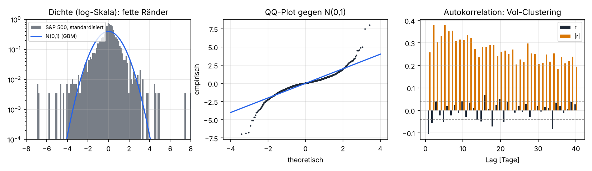
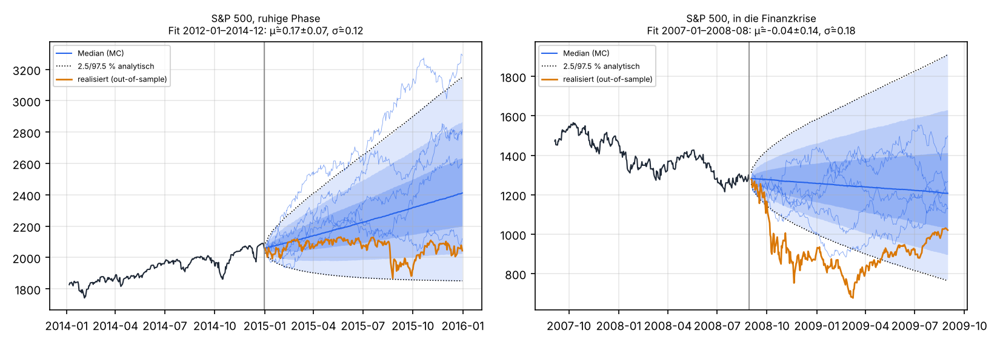
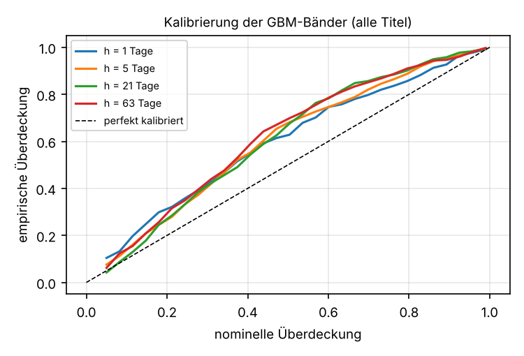
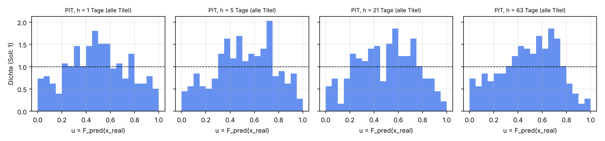
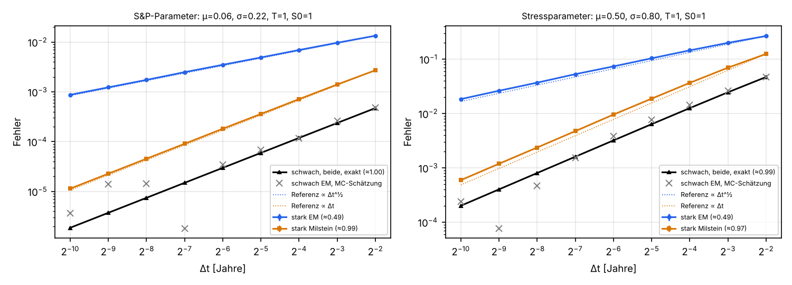

# Projekt 1 – Geometrische Brownsche Bewegung: schätzen, simulieren, ehrlich prüfen

**Frage:** Wie gut beschreibt das einfachste Kursmodell, $dS = \mu S\,dt + \sigma S\,dW$, echte Aktienkurse, und was
kann man damit *vorhersagen*?

**Antwort in drei Sätzen:**
1. Die **Richtung** (Drift μ) ist praktisch nicht schätzbar: Der Standardfehler ist $\sigma/\sqrt T$, bei 9 Jahren S&P-Daten
   ±7 % p. a., so groß wie die Drift selbst. Out-of-sample hilft die geschätzte Drift nicht messbar gegenüber μ = 0.
2. Die **Schwankungsbreite** (σ) ist genau schätzbar und die Bänder sind brauchbar, aber im Backtest systematisch
   zu breit, weil σ in Wirklichkeit nicht konstant ist (Vol-Clustering) und das Schätzfenster dem Regime hinterherläuft.
3. Log-Renditen sind deutlich **nicht normal** (Exzess-Kurtosis 5–9), was die Projekte 2 (Heston) und 3 (Merton) motiviert.

## Dateien

| Datei | Inhalt |
|---|---|
| [`herleitung.md`](herleitung.md) | Alle Formeln mit Herleitung, Vorwissen und Lücken markiert |
| [`run.py`](run.py) | Erzeugt alle Zahlen und Abbildungen (≈ 12 s) |
| [`ergebnisse.md`](ergebnisse.md) | Automatisch erzeugte Tabellen |
| `abbildungen/` | Plots |

Code: [`src/stochmarkt/gbm.py`](../../src/stochmarkt/gbm.py) (Modell, MLE, Bänder), [`sde.py`](../../src/stochmarkt/sde.py)
(EM, Milstein), [`validation.py`](../../src/stochmarkt/validation.py) (Backtest).
Entscheidungen: ADR [0002](../../docs/entscheidungen/0002-datenquelle.md)–[0006](../../docs/entscheidungen/0006-validierung.md).

## Abbildungen

**Sind Log-Renditen normal?** Nein: fette Ränder und Volatilitäts-Clustering.

**Fächer vs. Realität.** Links: ruhige Phase, Kurs bleibt im Band, aber die geschätzte Drift (μ̂ = 0,17 aus dem
Bullenmarkt 2012–14) war zu optimistisch. Rechts: Krise 2008, der Kurs verlässt das 95 %-Band für Monate.

**Kalibrierung im Rolling-Backtest (5 Titel, 2010–2016).** Über der Diagonale = Bänder zu breit.

**Euler-Maruyama vs. Milstein.** Starke Ordnung ½ bzw. 1, schwache Ordnung beide 1, wie die Theorie sagt.

## Grenzen und offene Punkte

- Nur ein Datensatz (2007–2016, 5 US-Titel). Mit `--source auto` aktuelle Daten testen.
- Fensterlänge 3 Jahre nicht variiert (bewusst, ADR 0006); Sensitivitätsanalyse offen.
- Keine Transaktionskosten, keine Handelsstrategie: Hier wird modelliert und validiert, nicht gehandelt.
